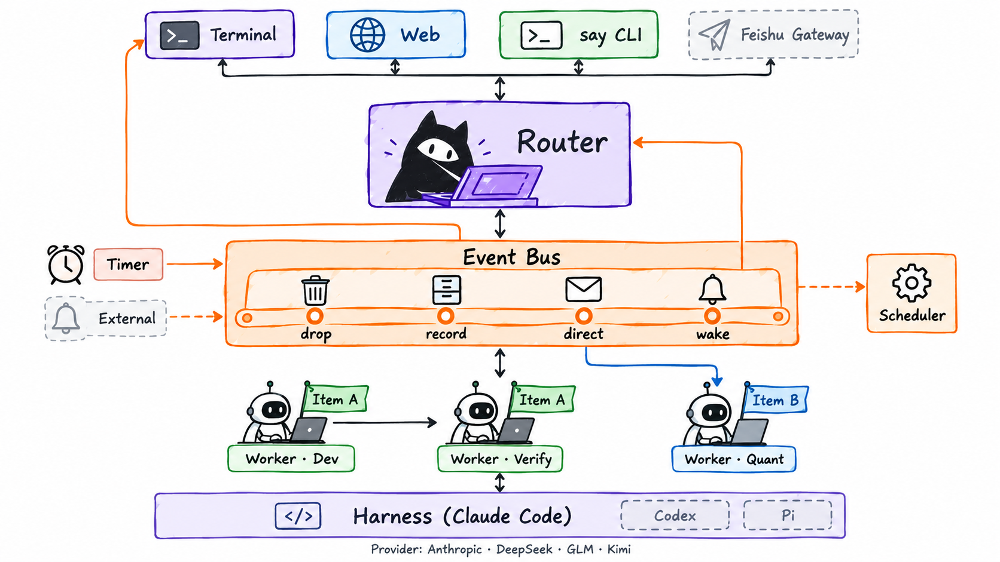
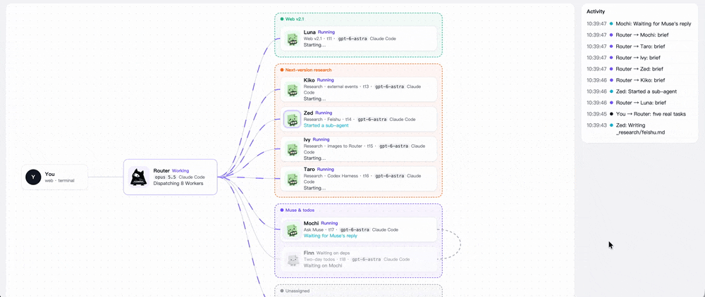
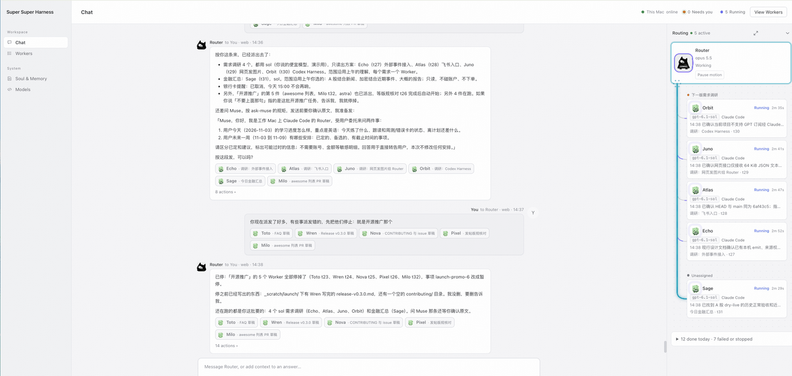
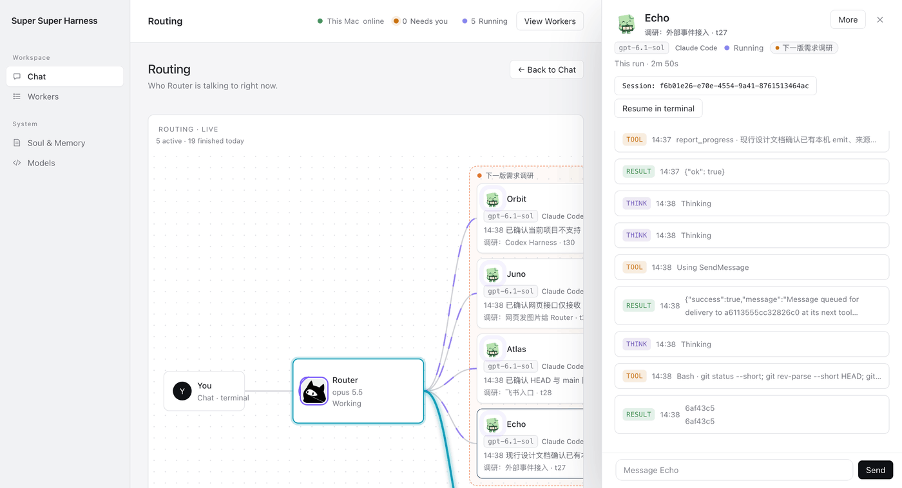
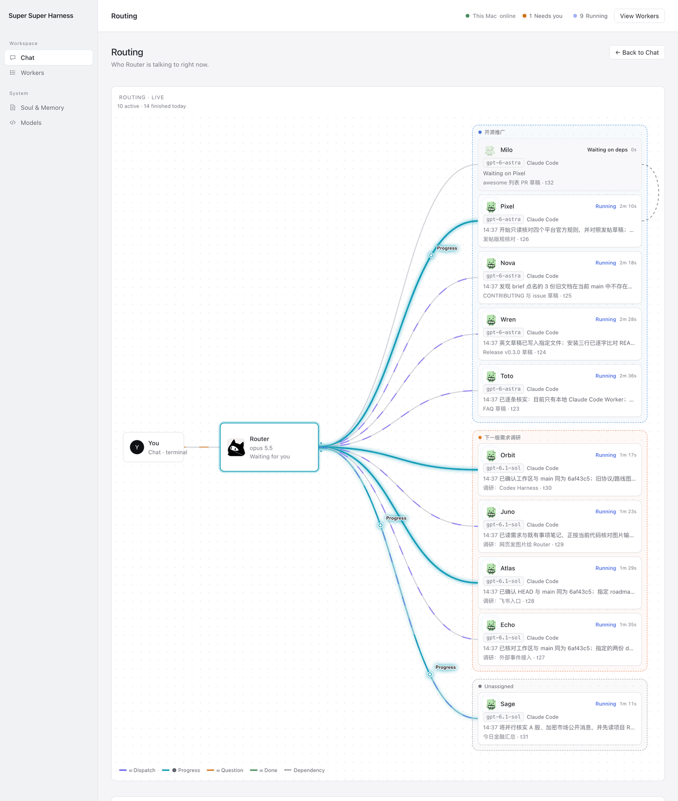
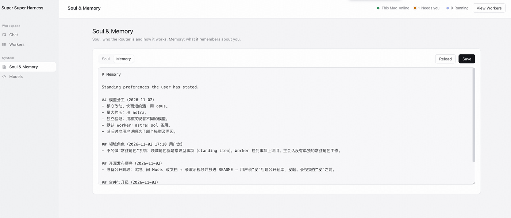
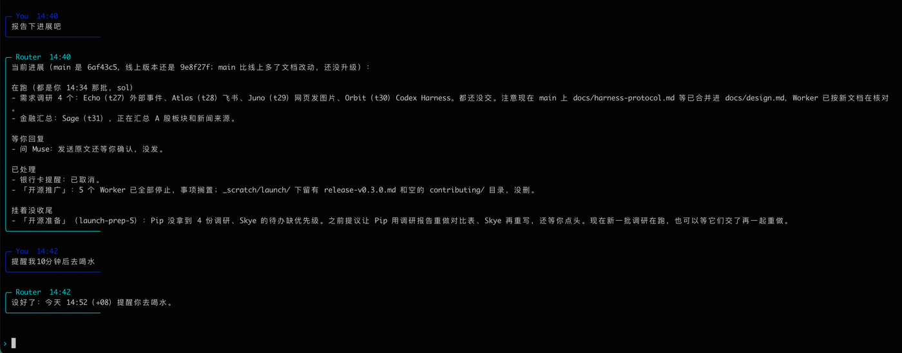
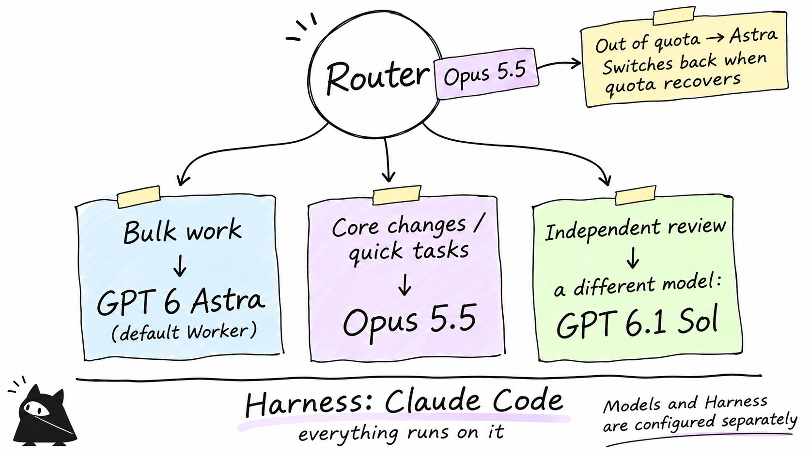

# Super Super Harness



English | [中文](README.zh-CN.md)

**Talk to one Router. A team of agents works in parallel in the background.**

Questions and results come back to you, and you can watch the work as it happens. The goal is a personal super-assistant like Muse; the design draws on DeepSeek's Super-agent work.



*Routing view prototype; the shipped page follows it.*

## Features

| | |
|---|---|
| One entry point | Terminal, web and CLI all talk to the same Router |
| Parallel Workers | Each on its own branch, with its own name and avatar; no stepping on each other |
| Items | Several Workers per item; the next starts when the previous one finishes |
| Proactive reports | Progress, questions and results come back on their own; decisions are one click |
| Routing panel | Beside the chat: who the Router is talking to and who is waiting on whom |
| Inspect | Open any Worker's session; resume it in a terminal |
| Scheduled tasks | Remind you on time, or wake the Router to do the work |
| Model failover | Out of quota, switch to a backup model; switch back when it recovers |

<table>
<tr>
<td width="50%"><br><sub>Chat, with the Routing panel beside it</sub></td>
<td width="50%"><br><sub>Inspect: open any Worker's session</sub></td>
</tr>
<tr>
<td rowspan="2"><br><sub>Routing: ten Workers in parallel, grouped by item</sub></td>
<td><br><sub>Soul & Memory: how the Router works and what it remembers</sub></td>
</tr>
<tr>
<td><br><sub>The same Router from the terminal</sub></td>
</tr>
</table>

## Architecture

- **One entry point**: agents never talk to each other directly; everything goes through the Router and the background service.
- **One door for events**: every event is dropped, recorded, sent to you or used to wake the Router, by rule.
- **Code handles dependencies**: when upstream finishes, downstream starts; the Router doesn't sit and wait.
- **Harness and model are decoupled**: Claude Code today, mix and match models.
- **Nothing gets lost**: everything lives in SQLite; restart and it picks up where it left off.

Details in [Design and protocol](docs/design.md).

## Quick start

You need macOS, Python 3.11+, Git, [Claude Code](https://claude.com/claude-code) and a key for an Anthropic-compatible model.

```bash
git clone https://github.com/ketchupz1999/super-super-harness.git && cd super-super-harness
bin/supersuperharness init      # pick a model, enter the key
bin/supersuperharness doctor    # check the environment
bin/supersuperharness serve     # start; keep this terminal open
bin/supersuperharness web --open   # in another terminal, open the web UI
```

My own setup: Opus for the Router, Astra for the bulk of the work, a different model for verification.



More in [Setup](docs/setup.md) and the [Guide](docs/guide.md).

> ⚠️ Workers have full permissions on your machine. Only run it on a machine you trust.

## Roadmap

| ✅ Done | 🚧 Next | 🗓 Later |
|---|---|---|
| Router + multiple Workers | Feishu | Codex |
| Items and dependencies | External events (GitHub CI) | Pi / DeepSeek Harness |
| Event bus | Soul and Memory | Cloud agents |
| Routing panel | Usage panel | |
| Scheduled tasks | | |

## Acknowledgements and license

Inspired by DeepSeek's *Exploring Super-agent Design* and [`dsh-superagent-prototype`](https://github.com/deepseek-ai/dsh-superagent-prototype). An independent project. [MIT License](LICENSE)
