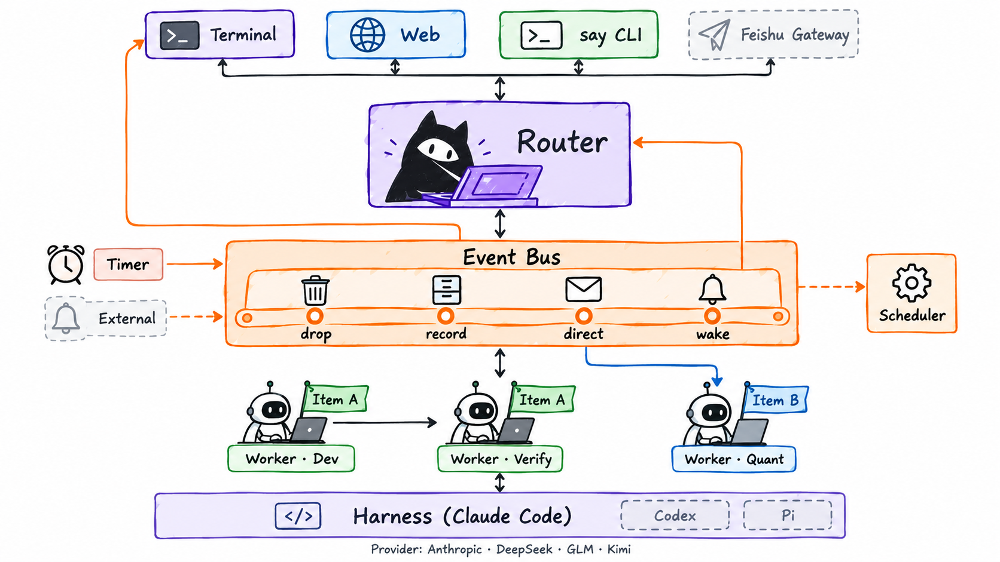
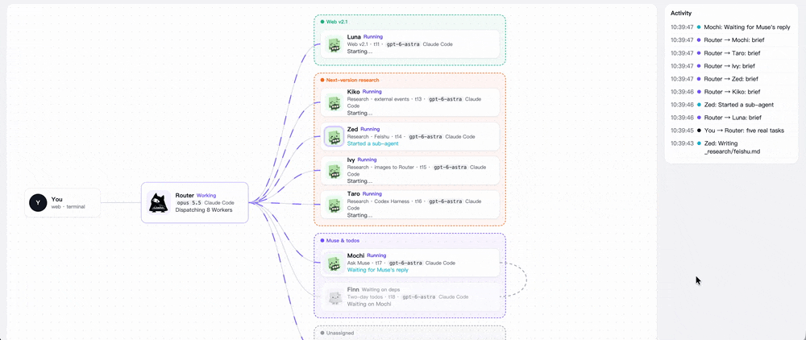
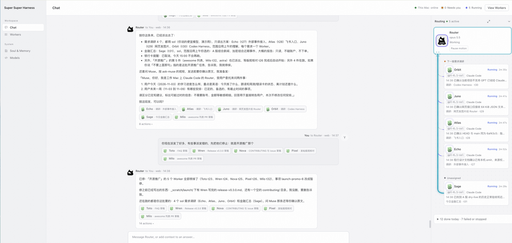
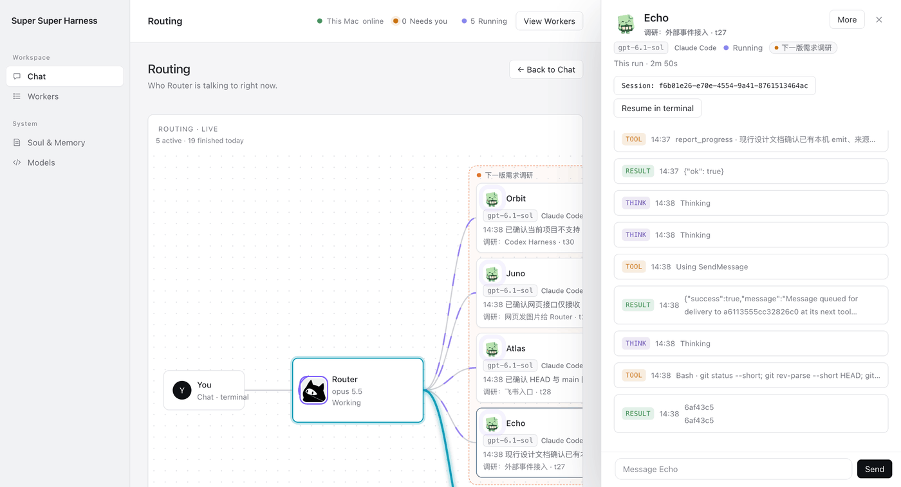
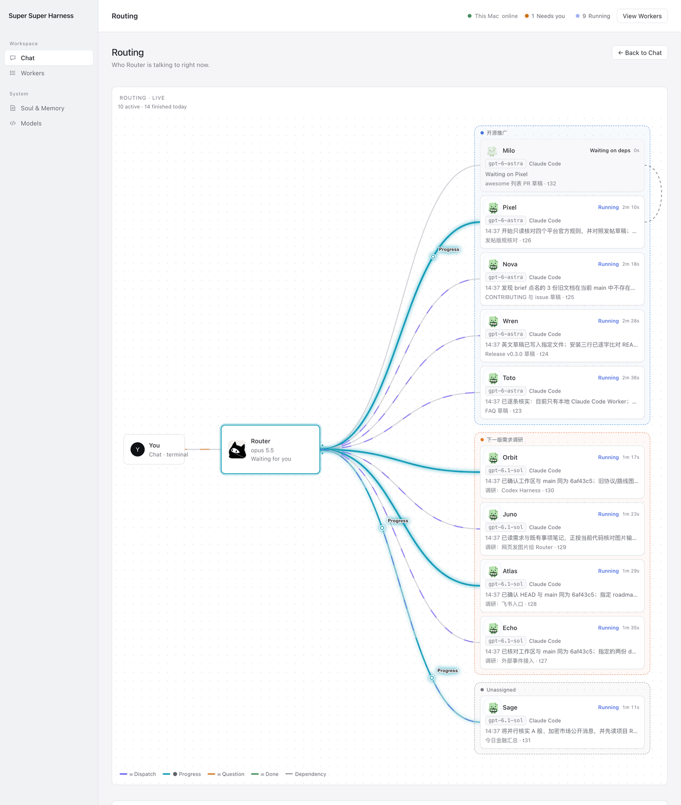
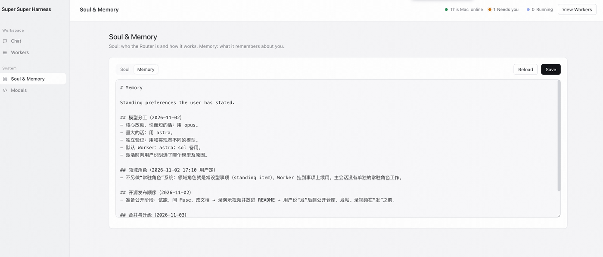
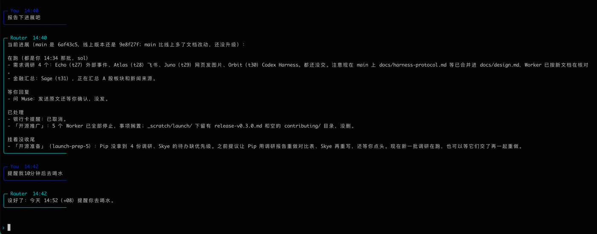
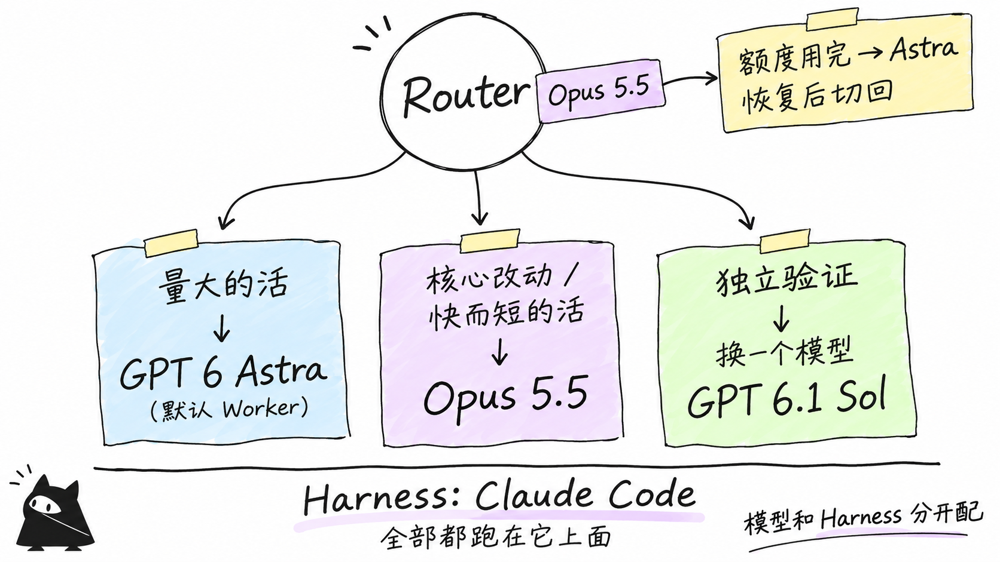

# Super Super Harness



[English](README.md) | 中文

**只和一个 Router 说话，让一群 Agent 在后台并行干活。**

问题和结果会自己回来，过程看得见。愿景是像 Muse 那样的个人超级助理，设计参考 DeepSeek Super-agent。



*Routing 视图原型录屏，正式页面按它实现。*

## 功能

| | |
|---|---|
| 一个入口 | 终端、网页、命令行都连同一个 Router |
| 多 Worker 并行 | 各自独立分支，有名字和头像，互不踩踏 |
| 事项 | 一件事挂多个 Worker，前一个做完后一个自动开始 |
| 主动汇报 | 进度、提问、结果自动回来；要拍板的事点按钮 |
| Routing 面板 | 就在对话旁边：Router 正在和谁说话、谁在等谁 |
| Inspect | 点开任一 Worker 看它的会话，也能到终端接管 |
| 定时任务 | 到点提醒你，或叫醒 Router 去干活 |
| 模型自动切换 | 额度用完换备用模型，恢复后切回 |

<table>
<tr>
<td width="50%"><br><sub>对话，旁边是 Routing 面板</sub></td>
<td width="50%"><br><sub>Inspect：点开任一 Worker 的会话</sub></td>
</tr>
<tr>
<td rowspan="2"><br><sub>Routing：十个 Worker 并行，按事项分组</sub></td>
<td><br><sub>Soul & Memory：Router 的工作方式和它记住的事</sub></td>
</tr>
<tr>
<td><br><sub>在终端里和同一个 Router 说话</sub></td>
</tr>
</table>

## 架构

- **一个入口**：Agent 之间不直连，都经过 Router 和后台服务。
- **事件一个入口**：所有动静按规则丢弃、记录、转给你或叫醒 Router。
- **依赖交给程序**：上游做完下游自动开始，Router 不用盯着等。
- **Harness 和模型分开**：现在跑 Claude Code，模型按需组合。
- **不丢消息**：全部存 SQLite，重启接着跑。

细节见 [设计与协议](docs/design.md)。

## 快速使用

需要 macOS、Python 3.11+、Git、[Claude Code](https://claude.com/claude-code) 和一个模型 Key。

```bash
git clone https://github.com/ketchupz1999/super-super-harness.git && cd super-super-harness
bin/supersuperharness init      # 选模型，输入 Key
bin/supersuperharness doctor    # 检查环境
bin/supersuperharness serve     # 启动，保持这个终端
bin/supersuperharness web --open   # 另开终端，打开网页
```

我自己的配置：Router 用 Opus，量大的活交给 Astra，验证换一个模型。



更多见 [安装与配置](docs/setup.md)、[使用指南](docs/guide.md)。常见问题（比如和 Claude Code sub-agents 有什么区别）见 [FAQ](docs/faq.md)（英文）。

> ⚠️ Worker 有完整的本机权限，只在你信任的机器上用。

## 路线图

| ✅ 已完成 | 🚧 接下来 | 🗓 以后 |
|---|---|---|
| Router + 多 Worker | 飞书 | Codex |
| 事项与依赖 | 外部事件（GitHub CI） | Pi / DeepSeek Harness |
| 事件总线 | Soul 与 Memory | 云端 Agent |
| Routing 面板 | 用量面板 | |
| 定时任务 | | |

## 致谢与许可

参考 DeepSeek 的 *Exploring Super-agent Design* 和 [`dsh-superagent-prototype`](https://github.com/deepseek-ai/dsh-superagent-prototype)，本项目独立开发。[MIT License](LICENSE)
